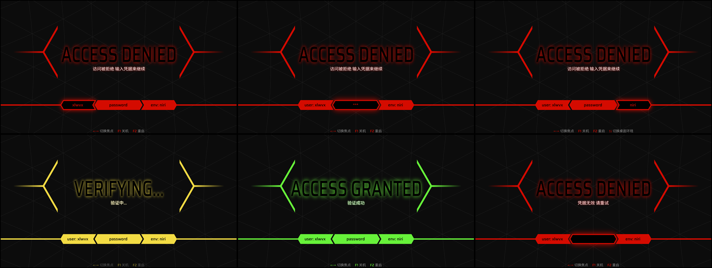

# PhigrAuth

一个按 `参考/要求.md` 实现的 TTY greeter（会话管理器）：原生 Rust + GTK4，全屏 Wayland 客户端。所有画面严格由 `参考/` 下的 8 个 SVG 与 `bg.ggb` 中的 GeoGebra 构造驱动。



启动动画分阶段截图见 [boot.png](docs/screenshots/boot.png)，`tty shell` 选项见 [env-tty-shell.png](docs/screenshots/env-tty-shell.png)。

## 功能

- **启动动画**（0–2s）
  - 0–1s：背景从黑色淡入；大字由小变大并淡入；两侧 `-<` / `>-` 从 `starting1.svg` 的位置滑入；0.7s 时大字闪烁两下。
  - 1–2s：画面元素整体上移 22.036 个 viewBox 单位，输入条从屏幕下方上浮到位，并在 1.7s 闪烁两下。
  - 两段进入动画均使用先快后慢的二次缓动（quadratic ease-out），不是线性。
  - 2s 后焦点移动到密码栏，底部提示淡入。
- **字体**
  - 中文：`Source Sans Pro` Normal（Regular）。
  - 英文/数字/按键名：`Saira` Medium。
  - 两个字体已内嵌到二进制中，用户不需要安装；`Source Sans Pro` 不含 CJK 字形，因此中文由内嵌的 **Noto Sans CJK SC Regular** 子集以相同字重回退，视觉上保持无衬线 Normal 中文。
- **登录界面**：用户名、密码、桌面环境三个输入条，任意时刻只有一个聚焦。
  - 用户名：未聚焦 `user:<内容>`；内容为空时只显示 `user`（不带冒号）；聚焦时只显示内容。
  - 密码：未聚焦 `password`，聚焦时按字符数显示 `*`。
  - 桌面环境：未聚焦 `env: niri`，聚焦时只显示环境名；此时底部额外显示 `↑↓ 切换桌面环境`。
  - 切换桌面环境时，旧文字先变成等大的实心方块，方块从上方往下收缩到文字下边缘，新文字从上方逐渐露出（见 [env-wipe.png](docs/screenshots/env-wipe.png)）。
  - 环境列表末尾始终附加一个 `tty shell` 选项，成功后启动用户的登录 shell（或配置的命令）。
- **验证流程**：回车进入 `verifying.svg`；成功为 `access granted.svg`。失败时先在暗红遮罩下瞬间切到完全就绪的 `retry.svg` 状态并**清空密码输入框**，再让全屏 `#550808` 在 0.1s 内褪去——红色退完时看到的就是 retry，不会看到 verifying→retry 的过渡。
- **成功退场**：元素在 1s 内上浮出屏、背景压暗至黑，随后启动所选会话并退出。
- **底部提示**：字号更小（7.4 viewBox 单位），基线贴近屏幕下边缘（y=283.6 / 285.75）。
- **电源操作**：F1 关机、F2 重启（真实调用 `systemctl`，可用 `--dry-power` 测试）。
- 背景完全按 `bg.ggb` 的构造渲染（三族曲线、k=0.00112、s=3.44、m=7、A/B/C/D = ±16/±9）。

## 构建

依赖：

- Rust（2021 edition）
- GTK4 开发包与 `pkg-config`
- PAM 开发头文件（`pam`）

Arch Linux 示例：

```bash
sudo pacman -S --needed rust pkgconf gtk4 pam
cargo build --release
```

字体无需安装：`assets/fonts/` 下已内嵌 Saira Medium、Source Sans Pro Regular 和用于中文回退的 Noto Sans CJK SC 子集。若希望任意中文用户名（超出 UI 子集字符）也能显示，建议系统再安装一个 CJK 字体；否则这些额外字符会依赖系统回退。

产物：`target/release/phigrauth`。

## Arch Linux 软件包

`packaging/` 下提供了可直接安装的 PKGBUILD：

```bash
cd packaging
./package.sh             # 生成源码包、更新校验和、makepkg -si
```

- 只构建不安装：`PKG_NO_INSTALL=1 ./package.sh`
- 跳过测试：`./package.sh --nocheck`
- 源码包已经生成，也可以直接 `cd packaging && makepkg -si`；`package.sh` 默认带 `-f`，修改源码后重新运行即可。
- `package.sh` 会重新打包当前工作树（不包含 `target/`、`packaging/src/` 等）。
- 首次构建需要联网下载 crate；软件包安装到 `/usr/bin/phigrauth`，文档在 `/usr/share/doc/phigrauth`，许可证在 `/usr/share/licenses/phigrauth`。
- 构建完成后也可以直接安装：`sudo pacman -U packaging/phigrauth-0.1.1-1-x86_64.pkg.tar.zst`。

## 运行

```bash
# 全屏启动（默认）
./target/release/phigrauth

# 开发窗口模式
./target/release/phigrauth --windowed

# 不真正执行 systemctl，只显示提示（测试 F1/F2）
./target/release/phigrauth --dry-power

# 指定配置文件
./target/release/phigrauth --config /path/to/config.toml

# 渲染各状态截图（无需图形会话），用于视觉对比
./target/release/phigrauth --snapshots ./snapshots
```

`--snapshots` 会输出 `boot_000`…`boot_220`、`login_*`、`retry`、`verifying`、`granted`、`failed_flash`、`exit_mid`、`env_wipe`、`env_tty_shell`、`denied_unfocused` 等 1920×1080 PNG。

### 默认用户

- `default_user` 为空时用户名字段**留空**（未聚焦时显示 `user`，不带冒号），不会预填当前进程用户名。
- 在 greetd 模式下同样留空；请直接输入目标账户，或用 `default_user` / `--user <name>` / `PHIGRAUTH_USER` 指定默认账户。
- 可用 `--user <name>` 或环境变量 `PHIGRAUTH_USER` 覆盖。

## 配置

默认查找顺序：`$XDG_CONFIG_HOME/phigrauth/config.toml` → `~/.config/phigrauth/config.toml` → `/etc/phigrauth/config.toml`。示例见 [`config.example.toml`](config.example.toml)。

```toml
auth_backend = "auto"
pam_service = "login"
default_user = ""
default_session = "niri"
sessions_dirs = ["/usr/share/wayland-sessions", "/usr/share/xsessions"]
poweroff_command = ["systemctl", "poweroff"]
reboot_command = ["systemctl", "reboot"]
launch_session = true
# tty_shell_command = ["/bin/bash", "-l"]
```

- `auth_backend`：`auto`（默认，检测到 `GREETD_SOCK` 时走 greetd，否则本地 PAM）、`greetd` 或 `pam`。
- `pam_service`：本地 PAM 模式的服务名，默认 `login`；greetd 模式使用 greetd 自己的 PAM 服务。
- `default_session`：优先匹配 `.desktop` 的 `Name`/`DesktopNames`；找不到时取第一个会话。
- `launch_session = false`：验证成功后只退出，不启动会话（开发/截图用）。
- `tty_shell_command`：可选，覆盖 `tty shell` 选项执行的命令；未设置时使用用户 passwd 中的登录 shell（`-l`）。
- 会话列表来自 `.desktop` 文件；`env:` 后显示 `DesktopNames` 的首项，因此 `niri.desktop` 显示为 `niri`；`tty shell` 始终位于列表末尾。

## 认证与权限

认证有两种后端：

- **greetd IPC**（推荐，`auth_backend = "auto"` 时自动启用）：当环境变量 `GREETD_SOCK` 存在时，PhigrAuth 通过 greetd 的 Unix socket 完成 `create_session` / PAM 对话，并在退场时发送 `start_session`。greetd 以正确的用户身份启动会话，因此 greeter 本身可以以非 root 的 `greeter` 用户运行（cage 下正常工作）。
- **本地 PAM**（`auth_backend = "pam"`）：直接调用 `pam` crate。`pam_unix` 需要读取 `/etc/shadow`，所以这种方式需要足够的权限；普通用户运行会得到 `PAM 系统错误`。

F1/F2 仍然直接执行配置里的 `systemctl` 命令。

> 如果以 greetd 启动却无法认证，检查 `/etc/greetd/config.toml` 中的 `command` 是否正确指向本程序，并确认 `GREETD_SOCK` 能在 `cage` 子进程中保留；也可以显式设置 `auth_backend = "greetd"` 诊断。

用于界面开发的测试后门（**不要**在生产 greeter 中设置）：

```bash
PHIGRAUTH_DEV_PASSWORD=test \
  ./target/release/phigrauth --windowed --dry-power --dev-mock
```

只有显式传入 `--dev-mock` 时才会启用；此时密码等于 `PHIGRAUTH_DEV_PASSWORD` 即视为成功，不会调用 PAM。

### 作为真正的 TTY greeter

GTK4 需要一个 Wayland 合成器。推荐用最小合成器 `cage` 包住本程序，并由 greetd 启动；greetd 会通过 `GREETD_SOCK` 完成认证和会话启动，因此 greeter 可以使用专用非 root 用户：

```toml
# /etc/greetd/config.toml
[terminal]
vt = 1

[default_session]
command = "cage -s -- /usr/bin/phigrauth"
user = "greeter"
```

该用户需要能打开 DRM/输入设备（通常加入 `video`、`input`、`seat` 等组，具体取决于发行版/合成器）。PhigrAuth 会自动检测 `GREETD_SOCK` 并使用 greetd 后端；不需要把 greeter 以 root 运行，也不需要 setuid 助手。

`tty shell` 在 greetd 模式下由 greetd 以认证用户身份启动登录 shell；在本地 PAM 模式下则继承 greeter 的 stdio。

greetd 模式下，niri 会话会直接以 `niri --session` 启动（与 `niri.service` 的 ExecStart 相同），而不是再经过 `niri-session` 包装脚本。这样可以避开 greetd 刚创建 systemd user manager 时 `niri-session` 过早退出、导致会话失败的问题。

## 操作

| 按键 | 行为 |
| --- | --- |
| `←` / `→` | 在用户名、密码、桌面环境之间切换焦点（循环） |
| `↑` / `↓` | 桌面环境栏聚焦时切换环境；伴随方块收缩动画 |
| 回车 | 提交验证 |
| 退格 | 删除当前栏最后一个字符 |
| `Ctrl+U` | 清空当前栏 |
| `F1` | 关机 |
| `F2` | 重启 |

## 实现结构

```
assets/                 从参考 SVG 提取的可复用图层（颜色/文字占位符）
assets/fonts/           内嵌字体与许可证（Saira / Source Sans Pro / Noto Sans CJK 子集）
src/fonts.rs            统一的 fontdb（先加载内嵌字体，再加载系统字体）
src/scene.rs            图层渲染、rich text（中文/英文分别选字体）、背景几何、合成
src/app.rs              状态机、输入、焦点、验证流程、动画时间轴
src/sessions.rs         .desktop 会话发现、tty shell、会话启动、电源命令
src/auth.rs             认证后端选择（greetd / 本地 PAM / 开发 mock）
src/greetd.rs           greetd IPC 客户端（create_session / 认证对话 / start_session）
src/config.rs           配置
tools/extract_assets.py 重新生成 assets/（参考 SVG 未做修改）
tools/prepare_fonts.py  重新生成内嵌字体与 CJK 子集
```

渲染方式：每个视觉层用 [resvg](https://github.com/linebender/resvg) 渲染成 Cairo surface，再由 GTK4 的 `DrawingArea` 按时间轴缩放/平移/淡入淡出合成。这样保留了 SVG 中的渐变、`feGaussianBlur` 辉光、字体与精确布局，同时避免每帧重新解析整份 SVG。

运行时文本会按字符脚本切分成多个 SVG `tspan`：CJK 使用 `Source Sans Pro` + `font-weight: normal`，其余使用 `Saira` + `font-weight: 500`。底部提示、错误提示、输入栏文字都走同一条路径。

### 时间轴

| 时间 | 内容 |
| --- | --- |
| 0–1s | 标题 `0.62 → 1.0` 缩放、透明度淡入；箭头从屏幕外滑入；背景淡入 |
| 0.7s | 标题闪烁两下 |
| 1–2s | 标题/箭头/副标题上移 22.036；输入条从 +116.947 上浮到 0 |
| 1.7s | 输入条闪烁两下 |
| ≥2s | 焦点切到密码栏，底部提示淡入（0.2s） |
| 验证 | 最短 0.9s 的 `verifying`；失败时在暗红遮罩下就绪 retry 并清空密码，遮罩 0.1s 褪去；成功进入 granted |
| 成功 | granted 停留 0.9s，随后 1s 上浮退场、背景变黑，启动会话并退出 |

### 背景

`bg.ggb` 的三组曲线族角度为 90°、30°、150°，即

```text
l1: x = -n·s
l2: (t·cos30° - n·s·sin30°, t·sin30° + n·s·cos30°)
l3: (t·cos150° - n·s·sin150°, t·sin150° + n·s·cos150°)
```

对每个点再乘以径向畸变 `1 + k·(x² + (y-oy)²)`，其中 `k=0.00112`、`s=3.44`、`oy=s/√3`、`n ∈ [-7,7]`。屏幕中心为原点，1 个世界单位 = 屏幕高度/18；线宽 = 屏幕高度/400；颜色 `#0c0c0c` / `#1c1c1c`。

## 字体与许可证

- 项目代码：**GPL-2.0-only**，完整许可证文本见 [`LICENSE`](LICENSE)。
- 内嵌字体：各自的 SIL Open Font License 1.1，许可证文件随字体一起放在 `assets/fonts/`。
- `assets/fonts/Saira-Medium.ttf` — Saira Medium，SIL Open Font License 1.1（见 `OFL-Saira.txt`）。
- `assets/fonts/SourceSansPro-Regular.otf` — Source Sans Pro Regular，SIL OFL 1.1（见 `LICENSE-SourceSansPro.md`）。
- `assets/fonts/NotoSansCJKsc-Regular-subset.otf` — Noto Sans CJK SC Regular 的子集，SIL OFL 1.1（见 `LICENSE-Noto-CJK.txt`）。

`tspan` 中指定的中文族名是 `Source Sans Pro`；该字体本身没有汉字，实际汉字由上面的 Noto Sans CJK SC 子集以相同 style/weight（Normal）回退。这样即使系统没有安装指定的两个字体，UI 也能保持正确。

## 测试

```bash
cargo test
```

覆盖：启动时间轴、焦点循环、密码遮挡、失败清空密码、环境切换、tty shell、greetd IPC 帧协议/认证/start_session、内嵌字体可用性。开发时还使用 Broadway + WebDriver 做端到端按键回归（截图在 `docs/screenshots/`）。参考 SVG 与 `bg.ggb` 未修改。

## 已知限制

- 文本输入基于 `GdkEventControllerKey` 的 keyval，未接入输入法（IME）；中文用户名请输入 ASCII 或后续接入 `GtkIMContext`。
- HiDPI 下图层按 GTK 逻辑像素渲染；如果合成器 scale > 1，细节可能有轻微放大模糊。
- 直接在非 root 用户下无法用 `pam_unix` 认证（见上）。
- 本地 PAM 模式自行启动会话，只提供最小环境；greetd 模式使用 greetd/PAM 创建的完整会话环境，生产使用应以 greetd 模式运行。
- `tty shell` 继承 greeter 的 stdio，不主动分配新 VT。
- 内嵌 CJK 子集只覆盖 UI 文案和少量常用汉字；任意中文用户名超出子集且系统无 CJK 字体时可能缺字。
- 无鼠标交互；仅键盘。

## 参考资源

- `参考/*.svg`：各状态的视觉规范
- `参考/bg.ggb`：背景构造（GeoGebra）
- `参考/要求.md`：需求与时间轴
